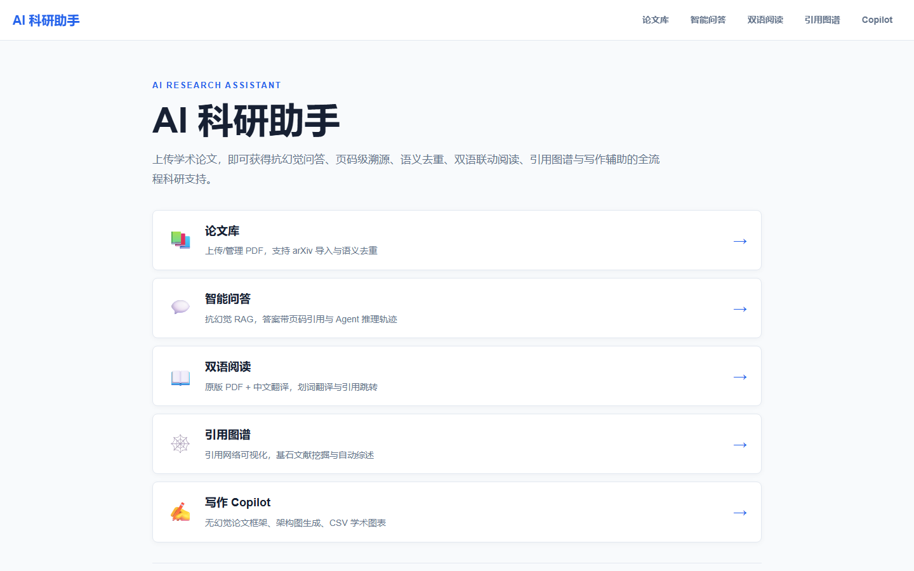
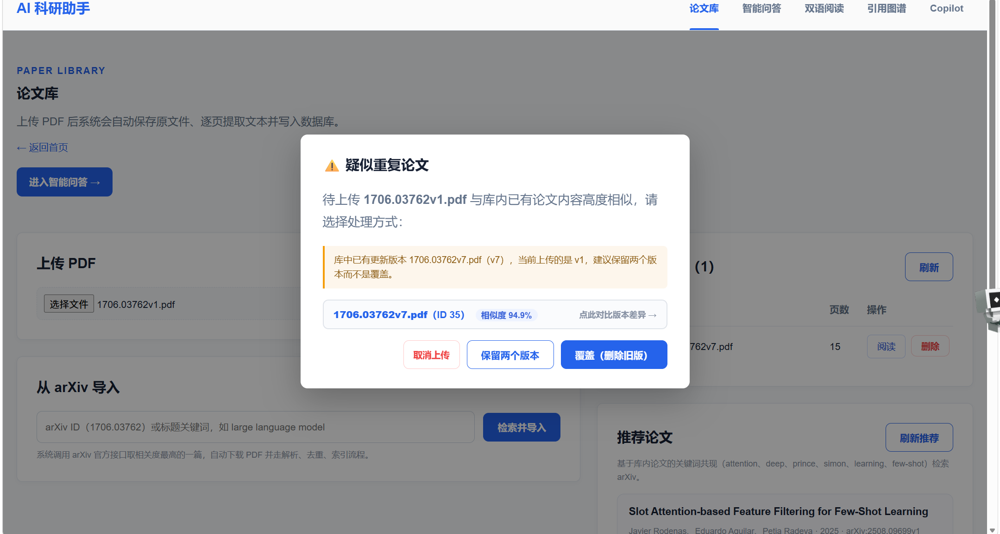
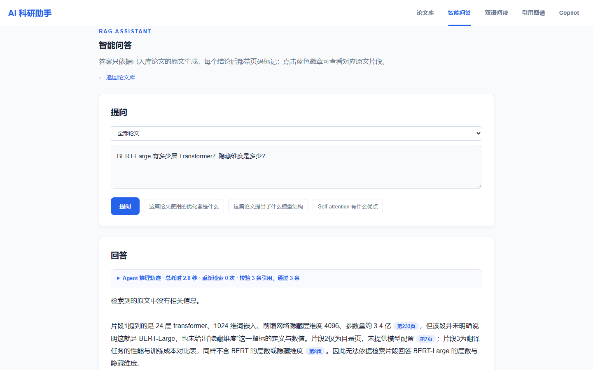
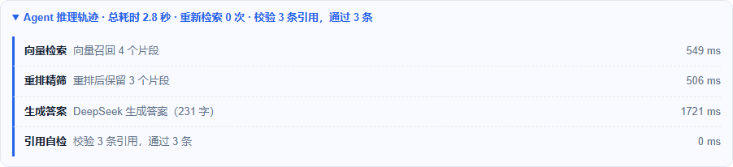
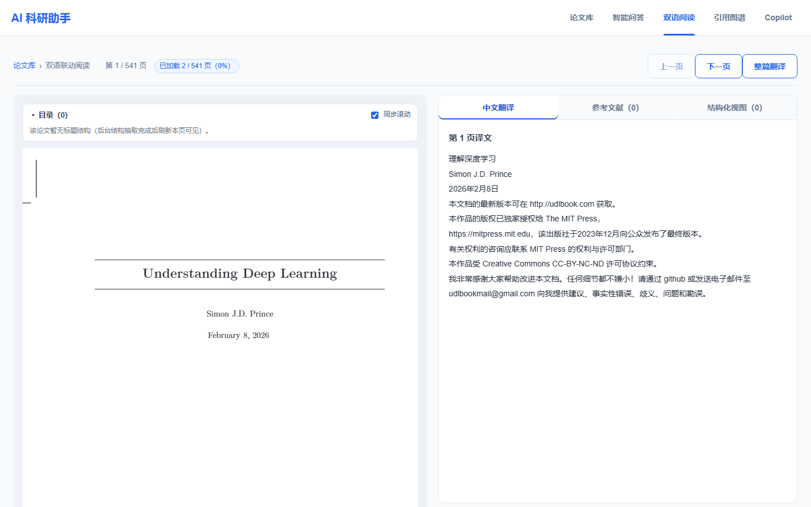
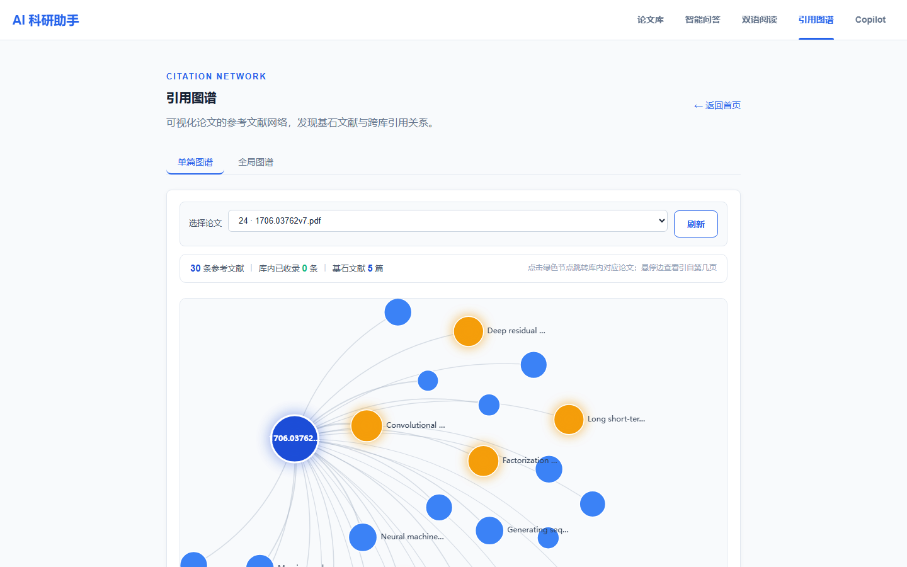

# AI 科研助手技术文档

**项目名称：** AI 科研助手——基于抗幻觉 RAG 与 Agent 的全流程科研工作台
**赛项：** 全国高校 AI 大模型挑战赛——科研助手 Agent
**开发方式：** Vibe Coding 人机协同（Trae + DeepSeek）
**文档版本：** 定稿 v2.0
**日期：** 2026-11-18

> 数据口径：本文数字来自真实接口、SQLite/Chroma 复核、浏览器验收、Git 历史与 PROGRESS.md。云端 embedding 存在小幅数值波动时同时列出留存值与复测值；没有原始记录的性能提升不写百分比。

<!--BODY-->
# 目录

[[TOC]]

# 第1章 项目概述与参赛声明

## 1.1 背景与目标

通用聊天模型能解释论文，却不能天然保证答案来自指定文献。科研阅读还需要处理扫描件、长文档、版本重复、原文核对、References 和写作材料。项目因此以“可核验”为主线，形成：**论文入库 → 页级解析 → 证据检索 → 受约束生成 → 引用自检 → 原文复核**。

系统不是单一聊天框，而是将同一套页码、文本块和 References 数据复用到问答、双语阅读、语义去重、引用图谱与写作 Copilot 中。每个 AI 结论都应能回到文件、页码或真实数据；证据不足时允许回答“没有相关信息”，而不是用常识补齐。

## 1.2 功能范围

| 模块 | 使用场景 | 已实现能力 |
|---|---|---|
| 论文库 | 上传矢量、扫描、长 PDF | 页级文本、OCR、标题/公式/表格/References、向量索引、删除同步清理 |
| 智能问答 | 核实论文事实、比较论文 | BGE-M3 召回、rerank、DeepSeek 生成、页码徽章、原文弹窗、Agent 自检重检索 |
| 语义去重 | 同一论文多版本或改名上传 | 全文语义指纹、0.92 阈值、保留/覆盖/取消、DeepSeek 修订摘要 |
| 双语阅读 | 阅读英文论文并核对引用 | PDF.js、划词/整页/整篇翻译、标题树、同步滚动、引用双向跳转 |
| 引用图谱 | 找基石文献与研究脉络 | References 建图、PageRank 与 importance、ECharts、自动综述 |
| 扩展工具 | 找新文献、准备写作材料 | arXiv 检索导入与推荐、论文框架、Mermaid/TikZ、CSV 图表与中英图注 |

## 1.3 主要创新点

1. **抗幻觉是工程闭环。** 不只写“不要编”，还检查页码是否属于本轮证据、引用句是否与原文重叠；失败会扩大检索，最终仍不能核实的引用标记会被删除。
2. **页码是系统元数据。** 页码从 PyMuPDF 解析阶段写入 SQLite 和 Chroma，不由模型猜测；问答、阅读和引用跳转共用同一页码体系。
3. **语义版本管理。** 文件名不参与相似度，v1/v7 或改名文件均能预警；用户决定是否保留，AI 进一步总结修订点。
4. **同源数据多功能复用。** 页级文本同时服务检索、翻译、References 跳转、图谱和 Related Work 引用校验，减少模块间重复解析与数据漂移。
5. **可解释图谱评分。** 节点重要性由 PageRank、正文提及、经典度和新鲜度共同决定，前端展示分数和理由。

## 1.4 是否发表或获奖

**本项目为首次参赛作品，此前未公开发表或获奖。**

## 1.5 是否基于其他项目优化

**本项目为原创开发，基于开源框架（Next.js、FastAPI、Chroma 等）搭建，未基于其他参赛项目优化。** 开源依赖用于通用 Web、PDF、向量检索和图形渲染；业务数据模型、页级溯源、四阶段 Agent、语义去重流程和交互页面由项目组在本赛项中实现。

开发过程中的迭代优化包括：去重静默失败修复、跨页断句与 References 恢复、图谱写死默认 ID 修复、加载进度与失败重试、ECharts 渲染重构和窄屏适配，详见第6章。

# 第2章 AI 开发方式与基础架构亮点

## 2.1 Vibe Coding 人机协同方式

项目采用 **Vibe Coding：AI 编码 + 人工验收决策**。主要工具为 **Trae**（代码阅读、编辑、终端、浏览器验收与 Git 留痕）和 **DeepSeek**（代码生成、报错分析、文档与 Prompt 迭代）；运行时另用 SiliconFlow 提供 BGE-M3 与 reranker。AI 不是一次性生成整站，而是在明确边界的小任务中持续实现，人负责目标、取舍和最终验收。

| 环节 | 人工职责 | AI 职责 | 可核验产物 |
|---|---|---|---|
| 任务定义 | 锁定 P0/P1/P2、官方用例和技术约束 | 将任务拆成可验证的小步骤 | PROJECT.md、AGENTS.md、任务清单 |
| 方案决策 | 选择部署、模型、重构范围与回滚时机 | 给出 2—3 个方案及利弊 | 代码评审记录、commit 说明 |
| 编码调试 | 提供完整报错、复现路径，审查关键数据流 | 编写 FastAPI/React、解析规则与样式，定位隐性假设 | 源码、依赖锁文件 |
| 测试验收 | 规定“必须有页码”“改名仍预警”等通过条件 | 执行接口、构建和浏览器回归，保存数值与截图 | PROGRESS.md、screenshots/ |
| 文档表达 | 判断结果能否公开、哪些数据不可编造 | 根据代码、Git 和实测整理文档与演示稿 | 技术文档、视频脚本 |

## 2.2 Next.js 静态导出 + FastAPI 单端口同域托管

开发时前后端分离；演示时 Next.js 14 通过 `output: "export"` 生成 `frontend/out`，FastAPI 用 StaticFiles 托管该目录。浏览器页面和 `/api` 均走 **8000 单端口、同一源**，再由 cpolar 暴露一个公网入口。

```text
浏览器
  ├─ /、/papers、/ask、/read、/graph  → FastAPI StaticFiles → Next.js 静态产物
  └─ /api/*                           → FastAPI 路由
                                      ├─ SQLite：论文、逐页文本、结构条目、缓存
                                      ├─ Chroma：文本块、向量、paper_id/page 元数据
                                      ├─ DeepSeek：生成、翻译、对比、综述
                                      └─ SiliconFlow：BGE-M3、reranker、Qwen-VL
```

这一形态避免了静态站点与 API 分域造成的 CORS、Cookie 和额外隧道配置；前端变更后必须重新 `pnpm build`，后端重启即可服务最新产物。Docker 采用两阶段构建，同一容器内完成前端导出与后端启动。

## 2.3 抗幻觉 RAG 管线与四阶段 Agent

正文切块约 500 字符、重叠 80 字符，窗口后半段优先在句末断开。每个 Chroma 条目包含 `(paper_id, filename, page, chunk)`；同篇同页只保留排名最高的一块，减少重叠内容挤占上下文。默认向量召回 top5，bge-reranker-v2-m3 精排后保留 top3。

| 阶段 | 输入与动作 | 失败处理 | trajectory 记录 |
|---|---|---|---|
| retrieve | 查询改写后向量召回；限定单篇时过滤 paper_id | 重试保持原问题，top-k 按轮次扩大 | 候选数、覆盖论文数、attempt、耗时 |
| rerank | 交叉重排，取高相关片段 | 重试新增页面，不挤掉已通过页面；重排异常退回向量顺序 | 新增数、累计片段数 |
| generate | DeepSeek 只看到带真实文件名和页码的片段 | 无证据须明确说没有，不得常识补齐 | 答案长度、耗时 |
| verify | 校验引用页码、论文编号和引用句内容重叠 | 最多重检索 2 轮；仍失败删除对应引用标记 | 引用总数、通过数、失败标记 |

系统使用显式状态循环而非为四个阶段引入重型框架，状态转移全部可读。跨论文模式还联合校验 `[论文N 第X页]`，防止把 A 论文证据贴给 B 论文。

## 2.4 数据与安全边界

SQLite 保存论文元数据、页文本和结构条目；Chroma 保存检索向量；原始 PDF 供 PDF.js 按需 Range 加载。模型密钥仅从 `.env` 注入，`.env` 被 Git 忽略，仓库只保留 `.env.example` 占位符。删除论文时同步删除 SQLite 记录、Chroma 向量和磁盘文件，避免已删论文再次出现在答案中。

# 第3章 关键支持技术与核心实现

## 3.1 技术、用途与选择理由

| 技术 | 用途 | 选择理由 |
|---|---|---|
| PyMuPDF | 逐页文本、页码、页面渲染、扫描页判定 | 解析接口统一、速度快，541 页实测可稳定遍历；无文本层时转 OCR |
| Chroma | 本地持久化向量库与 paper_id/page 过滤 | 嵌入式、零独立服务，支持余弦距离，适合单机演示和快速交付 |
| BGE-M3 | 论文块与查询 embedding、全文语义指纹 | 中英文学术文本适配好，1024 维；入库和查询固定同一模型保证向量可比 |
| bge-reranker-v2-m3 | 对向量候选做交叉精排 | 召回解决“大致相关”，重排解决“问题与片段是否真正匹配” |
| DeepSeek API | 问答、翻译、版本对比、综述与写作 | 中文指令遵循和学术生成满足需求，API 成本适合多模块复用 |
| SiliconFlow | 托管 BGE-M3、reranker、Qwen-VL | 免本地下载模型，统一 OpenAI 兼容接口；模型名可由环境变量切换 |
| Next.js 14 + React | 论文库、问答、阅读器、图谱等页面 | App Router 组件化清晰，静态导出便于单端口部署 |
| FastAPI | REST API、静态托管、后台索引 | 类型声明、Swagger 和 Python AI 生态集成顺畅 |
| PDF.js 4.10.38 | 原版 PDF、文本层和划词 | 保留论文版式，worker 本地部署；版本锁定避免新 API 浏览器兼容问题 |
| ECharts | 力导向引用图、邻接高亮、缩放 | 图形交互成熟；替代 React Flow 后解决空白 MiniMap 和初始视野裁切 |
| NetworkX | 有向引用图与加权 PageRank | 图算法可靠，便于和正文提及、经典度组合评分 |
| arXiv API | ID/关键词检索、PDF 下载与推荐 | 官方 Atom 数据源；下载校验 `%PDF` 文件头后复用统一入库链路 |
| Chart.js | CSV 柱状图、折线图和表格切换 | 轻量、交互直接，配合后端真实列统计生成图注 |
| SQLite | 论文、页面、结构条目和缓存 | 零部署、易备份，满足当前单实例关系数据需求 |
| cpolar | 将本地 8000 映射为公网演示地址 | 只需一条隧道，适合比赛演示；免费随机域名依赖开发机在线 |

## 3.2 PDF 解析、OCR 与结构化

矢量页用 `page.get_text("text")` 提取，页码从 1 开始。一页少于 50 字符即疑似扫描页：以 150dpi 渲染 PNG，最多 4 页并发调用 Qwen-VL；单页超时 300 秒，空文本或超时允许重试一次。单页失败不会伪报成功，也不会阻断其他页面。

结构化采用“规则优先、LLM 兜底”：章节编号、表格线和 `[n]` 引用具有稳定版式，规则零成本且可复现；首页标题和作者规则无法抽取时才调用一次模型。References 取最后一次独立标题，跨页条目保留字符区间到页码的映射。正文 RAG 块不跨页，References 才做跨页恢复，两者都保留溯源锚点。

## 3.3 语义去重与版本差异

新论文和库内论文各取全文前 15000 字，组成一次 batch embedding，逐对计算余弦相似度。阈值默认 **0.92**；文件名不参与计算。超过阈值返回 HTTP 309、相似论文和暂存 token，用户可保留两个版本、覆盖旧版、取消或先比较差异。

版本对比取两版文本开头 2000 字和结尾 2000 字，要求 DeepSeek 输出总体判断、章节增删改、关键数字差异和一句话修订方向。官方样例能指出 EN-FR BLEU 从 41.0 到 41.8，而不是只做字符 diff。

## 3.4 双语联动阅读

左侧 PDF.js 渲染原版 canvas，透明文本层按坐标定位，支持划词；右侧提供中文翻译、References 和结构化视图。整篇翻译按页串行并显示进度，相同文本命中缓存后不再请求模型。左右栏按可滚动区间比例同步，120ms 时间锁避免滚动回声。

正文 `[n]` 可跳到 References 并高亮，文献条目可回到正文首现页。PDF 使用 `disableAutoFetch=true`、`disableStream=true` 和 64KB Range；只缓存当前页及前后各一页，首页可见后预取邻居，离页释放。

## 3.5 引用图谱、arXiv 与写作 Copilot

引用边权为 `1 + 正文提及次数`。重要性评分为：

```text
importance = 100 × (0.35 × PageRank归一 + 0.15 × 正文提及归一
                    + 0.40 × 领域经典度 + 0.10 × 年份新鲜度)
```

ECharts 将本论文固定为中心，节点大小映射 importance，基石文献用橙金光晕；点击节点查看作者、年份、页码、提及次数和原始条目。无 References 时返回空图而不是服务器错误。

arXiv 支持 ID 精确查询和关键词检索，推荐按库内主题关键词共现与年份排序。写作 Copilot 只引用库内 `L<ID>`，后端再次校验引用键；CSV 图注只依据列统计和样本，模型失败时用本地统计兜底。

# 第4章 AI 加速技术落地：四个实测实验

## 4.1 实验一：语义去重、顺序反转与静默失败修复

**目的。** 验证预警依据是文本语义而非文件名，并检查上传顺序、版本提示和异常分支。方法是对 v1/v7 全文样本调用同一 BGE-M3，计算余弦值；每次从空库开始，第一篇直接入库，第二篇观察 309 和相似度。

| 测试顺序与操作 | 实测结果 | 结论 |
|---|---|---|
| v7 → v1（官方留存） | v7 直接入库；v1 返回 309，similarity=**0.9489（94.9%）** | 超过 0.92，提示库内已有更新版本 |
| v1 → v7（隔离空库复测） | v1 HTTP 200；v7 HTTP 309，similarity=**0.9493** | 顺序反转仍预警，不依赖“新版必须先在库” |
| v7 → v1（隔离空库复测） | v7 HTTP 200；v1 HTTP 309，similarity=**0.9483** | 云端 embedding 有小幅波动，结论不变 |
| v1 改名为 mypaper.pdf | 与库内 v1=100.0%，与 v7=94.9%，仍弹窗 | 文件名不是判断依据 |
| 保留/覆盖/取消/版本对比 | 保留后两条；覆盖后一条；取消清理暂存；对比给出 41.0→41.8 | 用户决定不被 AI 代替 |

复测值 0.9483/0.9493 与早期 0.9489 相差约 0.001，文档不把它们伪写成完全相同的数；三者都高于阈值。隔离测试使用临时 SQLite、PDF 和 Chroma 目录，不污染演示库。

**静默失败案例。** 联调中曾出现“后端实际返回去重响应，但页面没有弹窗”的静默失败：非 2xx 的 309 容易落入通用上传失败分支，用户看不到可选操作。修复是把 `response.status === 309` 放到 `response.ok` 判断之前，token 同时从 body 与 `X-Dedupe-Token` 恢复；随后用官方顺序和反转顺序复测，94.9% 弹窗、保留和覆盖路径均可见可操作。对应交互见图5-2。

## 4.2 实验二：扫描件 v1_img 多模态 OCR

输入为 `1706.03762v1_img.pdf`。该 PDF 共 15 页，但文本层仅能提取约 28 字符，符合图片型扫描件特征，不能靠调整普通文本提取参数解决。

| 指标 | 实测值 |
|---|---|
| OCR 页数 | **15/15 页成功** |
| 空白页 | `empty_pages=0` |
| 提取字符 | **37,741** |
| 向量块 | **94** |
| 识别参数 | 150dpi、4 页并发、300 秒单页超时、最多 2 次尝试 |
| 失败修复 | 第2页曾在 180 秒超时丢失；调至 300 秒并重试后约 140 秒完成 |

OCR Prompt 禁止 Markdown/LaTeX，要求按阅读顺序输出纯文本、表格按行、公式用 Unicode 近似，避免 `\begin{center}` 等排版命令污染后续检索。真实接口回归留痕于 commit `d77a845`。

## 4.3 实验三：541 页长文档结构化与页级溯源

输入为 `UnderstandingDeepLearning_02_09_26_C.pdf`。解析、结构化和向量索引是不同统计口径，分别记录如下。

| 指标 | 实测值 | 数据口径 |
|---|---|---|
| 总页数 | **541 页** | PyMuPDF 遍历 |
| 上传与文本解析 | **9.74 秒** | 原始压测记录 |
| 提取字符 | **1,314,451** | 原始压测记录 |
| 峰值内存 | **352MB** | 原始压测记录 |
| 结构化条目 | **459 条** | 2026-11-18 SQLite 复核 |
| 其中章节标题 | **337 条** | `structure.type=heading` |
| 其中公式 | **120 条** | `structure.type=formula` |
| 其余结构条目 | 论文标题、作者各 1 条 | 337+120+1+1=459 |
| 向量检索块 | **3,716 块** | Chroma `paper_id` 过滤复核 |
| 可索引页 | **537/541 页** | 4 个低文本页不硬塞向量库 |

459 是结构化条目数，3,716 是 RAG 向量块数，二者不能混写。系统可按指定页命中目标片段，页码徽章打开的原文与 PDF 页一致，证明长文档不仅“能上传”，还可检索、可定位。阅读页首屏只加载当前页附近内容，见图5-5。

## 4.4 实验四：抗幻觉问答、错误前提纠正与 verify 重检索

2026-11-18 对 v7 走真实 `/api/ask` 接口复测，结果如下。

| 问题 | 答案要点 | 引用自检 | 本轮轨迹 |
|---|---|---|---|
| 优化器是什么？β1、β2、ε 分别是多少？ | Adam；β1=0.9、β2=0.98、ε=10^-9，均为第7页 | **2/2 通过，重检索 0 次** | retrieve 752ms；rerank 473ms；generate 1218ms |
| “Transformer 是以 LSTM 为核心的循环网络，对吗？” | 明确回答“不对”；指出其完全依赖 attention、摒弃 recurrence | **3/3 通过，重检索 0 次** | 第1、2、10页；retrieve 615ms；rerank 437ms；generate 1698ms |
| BERT-Large 层数与隐藏维度 | 不用相似片段冒充直接证据，说明现有片段不足以确认 | 截图中 3/3 通过 | 图5-3、图5-4 |

错误前提纠正的关键不是模型“知道 LSTM 不对”，而是它能把否定结论绑定到真实页码。verify 先检查 `[第X页]` 是否属于本轮上下文，再检查引用句中的英文专业词、数字或中文词组与原页是否重叠。失败时保持原问题，按轮次扩大 top-k，新增页面而不替换已通过页面；最多重试 2 轮，仍失败则删除对应引用标记。这样形成“生成—证伪—补证—降级”闭环，而不是把 Prompt 中的“不要幻觉”当作保证。

# 第5章 项目功能场景、截图与 Prompt 说明

## 5.1 首页：统一科研工作台

适用于评审或用户首次进入系统，从论文入库开始，再进入问答、阅读、图谱或写作模块。五个入口共享同一后端与文献库。



## 5.2 语义去重：版本上传与人工决策

适用于同一论文多版本、改名文件或重复资料入库。AI 负责发现相似和总结差异，人决定保留、覆盖或取消。下图为 v1 上传时触发的 94.9% 预警；源文件名虽为 `08_抗幻觉问答.png`，实际画面是去重弹窗，本文按真实内容引用。



## 5.3 智能问答：证据不足不作答、结论可回查

适用于询问优化器、实验数字、模型结构或比较多篇论文。点击页码徽章可核对原文；遇到错误前提先纠正，证据不足时明确拒答，不拿相似段落冒充目标事实。



## 5.4 Agent 轨迹：让检索和自检过程可解释

适用于答辩、调试和复盘。面板展示四阶段耗时、召回与重排数量、生成字数、引用通过数和重检索次数。下图为一次问答的 4 片段召回、3 片段精排、231 字生成及 3/3 引用通过。



## 5.5 双语阅读：长文档原版与中文对照

适用于英文论文和教材阅读。左侧保留原版，右侧整页翻译；支持划词、标题树、同步滚动和引用跳转。下图为 541 页教材第1页，顶部展示已加载页数与整篇翻译入口。



## 5.6 引用图谱：发现基石文献

适用于整理 Related Work 和了解研究脉络。中心为当前论文，周围为 References；橙色节点表示高重要性文献，点击可查看原文条目、页码与评分理由。



## 5.7 四段式结构化指令模板

项目将 Prompt 统一为“**角色—任务—约束—输出**”四段，减少目标漂移。模板如下：

```text
【角色】你是谁，处理什么专业材料；
【任务】只做什么，输入范围是什么；
【约束】禁止什么，证据不足怎么办，页码/引用键只能从哪里来；
【输出】规定语言、字段、格式、长度和失败时的降级形式。
```

**真实 Prompt 示例一：抗幻觉问答。** 这是 `rag.py` 中实际规则的压缩展示，检索片段在 user 消息中按“文件+页码+正文”拼接。

```text
【角色】你是严谨的科研论文问答助手。
【任务】只能依据【检索片段】回答用户问题，先给结论，再给必要解释。
【约束】每个事实后紧跟[第X页]；页码只能来自片段标题；没有的信息直接回答
“检索到的原文中没有相关信息”，不要用常识补充或猜测。
【输出】中文；不多页复述原文；多页证据写作[第2页][第7页]。
```

**真实 Prompt 示例二：扫描页 OCR。** 用于 Qwen-VL，温度设为 0。

```text
【角色】你是 OCR 引擎。
【任务】逐字提取这一页学术论文图片中的全部文字，按阅读顺序输出。
【约束】不要使用 LaTeX、Markdown 或排版标记；表格按行；公式用 Unicode 近似。
【输出】只输出识别到的正文纯文本，不解释、不添加页外内容。
```

**真实 Prompt 示例三：版本修订摘要。** 用于 DeepSeek 对 v1/v7 的头尾采样文本做语义对比。

```text
【角色】你是学术论文版本对比助手。
【任务】比较同一论文的两个版本，不逐行复述，归纳真正的修订。
【约束】只能依据给定两版文本；关键数字必须来自材料，无法确认就写无法确认。
【输出】中文四部分：总体判断；主要新增/修改/删除章节；关键数字差异；
一句话修订方向。每点1—3行。
```

# 第6章 项目组内耦合优化与验收驱动开发

## 6.1 以可复现验收推动跨层修复

项目不是按“前端完成、后端完成”割裂验收，而是从用户用例反向检查 API、数据、模型和界面。下表四项均涉及多个层，单改 Prompt 或单改 CSS 无法解决。

| 验收问题 | 根因定位 | 修复与联动 | 实测结果 |
|---|---|---|---|
| 去重响应出现但页面无弹窗 | 309 非 2xx 易被通用失败分支吞掉 | 前端先处理309；后端 body/header 双通道 token；compare 只读不消费 token | 正序/反转均弹窗；保留、覆盖、取消可操作 |
| Adam 段落检索不到、References 跨页错位 | 500字硬切断句；PDF碎裂换行；跨页条目页码映射丢失 | 正文页内句边界+80字重叠；References 才跨页合并并保留页码映射 | Adam 第7页 2/2 引用通过；长文档可页级回查 |
| 清空重传后 /graph 报“论文24不存在” | 前端默认 `paper_id||24`，导航也写死24 | 移除默认值；先拉 `/api/papers`，选URL指定且存在的论文，否则选最新；404清除选择 | commit `65d1f88`；过期24不报错，v7单篇图正常 |
| 阅读页长时间等待、失败后卡加载 | 请求无统一超时，进度和重试状态不清 | 15秒 AbortController；加载页数、错误横幅、重试按钮；按需加载与缓存 | commit `447f065`；541页显示加载进度，失败可重试 |

## 6.2 数据耦合优化

页码从解析层一次生成，被 Chroma 元数据、问答徽章、阅读跳页和 References 共同使用；结构条目只解析一次，同时供标题树、图谱和综述使用。这样避免各模块自行猜页码或重复解析。删除操作同步清理三种存储，防止“列表已删、向量仍可问”的数据漂移。

## 6.3 渲染与部署耦合优化

引用图谱保留后端数据接口，只将 React Flow 渲染层重构为 ECharts，解决 MiniMap 空白、fitView 裁切和缩放控制问题。前端静态导出与 FastAPI 同域后，公网只需一条 cpolar 隧道；阅读页 PDF 不做 GZip，保留 Range 所需长度标头，普通 JS/CSS 则压缩传输。

## 6.4 失败可见与可恢复

外部模型不可用时，系统区分“可降级”和“必须告知”：rerank 失败可退回向量排序，OCR 失败页必须显示警告，引用无法核实要删除假锚点。前端统一骨架屏、空状态、中文错误横幅和重试入口，避免把网络、限流或空数据都表现成白屏。

# 第7章 AI 协同贡献与 Prompt 调优策略

## 7.1 人机贡献边界

AI 主要贡献高频编码、反例提示、报错定位和文档整理；人主要负责赛题理解、优先级、技术栈锁定、密钥安全、是否回滚以及最终是否可提交。尤其在数据真实性上，AI 提供记录和计算，人决定哪些结果可以写入文档。

| 工作 | 开发者贡献 | AI 贡献 |
|---|---|---|
| 架构与取舍 | 确认同域部署、模型供应商、重构范围 | 比较方案依赖、风险和实现成本 |
| 核心实现 | 审查页码、token、删除和引用数据流 | 编写解析、RAG、Agent、图谱和 React 页面 |
| 调试 | 提供完整报错与验收标准，决定是否回滚 | 定位 PDF.js 兼容、跨页断句、默认ID、窄屏溢出等 |
| 测试 | 确认官方顺序、反向边界和错误前提 | 执行真实接口、数据库复核、浏览器回归并保存证据 |
| 文档 | 审核首次参赛、原创性和数据口径 | 合并代码、Git、PROGRESS 与截图形成定稿 |

AI 的非代码贡献包括指出隐性假设：硬切可能破坏证据句、星型图 PageRank 区分度不足、作者缩写会被误认为句号、静态构建会固化写死参数。这些问题都由实测确认后再修，而非凭模型建议直接接受。

## 7.2 约束驱动的协同流程

1. 用 PROJECT.md/AGENTS.md 锁定目标、技术栈、密钥约束和官方用例。
2. 每次只做一个边界清晰的任务，要求列出文件、验证命令和原理。
3. 完成后立即构建或真实接口验收，再 commit；失败优先回到最近可用版本。
4. PROGRESS.md 记录完成项、原始报错、实测数字、阻塞和下一步。
5. 长会话通过“新会话 + PROGRESS + 交接摘要”恢复上下文，不凭印象续写。
6. 文档只引用能复核的数据；无旧版首屏毫秒记录时，不写虚构提升百分比。

## 7.3 Prompt 调优案例

| 初始问题 | 调优动作 | 实测结果 |
|---|---|---|
| 只写“不要幻觉”仍可能配错页 | 强制页码来自片段标题，verify 做页码与 overlap 校验，失败重检索 | Adam 2/2、错误前提 3/3 引用通过 |
| 500字硬切截断 Adam 证据句 | 改为约500字、后半窗句末断开、重叠80字；与检索约束联动 | 第7页证据稳定召回 |
| OCR 输出 LaTeX 排版污染检索 | 明确纯文本、阅读顺序、表格按行、Unicode 公式，温度0 | 扫描件15/15页成功，94个向量块 |
| Future Work 重复论文已做工作 | 输出 JSON 强制包含 prior_work，并提供 Limitation 与 Top8 引用 | 每个方向需交代与已有工作的边界 |
| 版本对比变成大段复述 | 限定四类输出、每点1—3行、数字只能来自两版材料 | 能指出 EN-FR BLEU 41.0→41.8 |

## 7.4 开发者主导的关键取舍

- 优先溯源自检、原文弹窗和重试，不投入非核心本地 LaTeX 编译链。
- 四阶段加回退边采用轻量显式状态机，保证状态转移可读，而非为形式引入框架。
- 为修复图谱视野与缩放问题替换 ECharts，但保持后端接口不变。
- 公网采用单端口 + cpolar，减少部署组件；同时如实说明随机域名和开发机在线限制。

# 第8章 综合验证与已知限制

## 8.1 综合验收结果

| 验收项 | 实测结果 |
|---|---|
| 官方去重顺序 | v7→v1 触发94.9%预警；改名仍预警；保留/覆盖/取消通过 |
| 扫描件 | 15/15页 OCR，37,741字符，94个向量块 |
| 长文档 | 541页、459结构条目、3,716向量块，指定页检索可回查 |
| 问答 | Adam 超参数带第7页引用；错误前提被纠正；引用自检有轨迹 |
| 阅读 | 标题树、整篇翻译、同步滚动、引用双向跳转；15页整篇翻译约35秒 |
| 图谱 | 单篇/全局切换、节点详情、缩放复位；无 References 时显示空状态 |
| Copilot | 9×5 CSV 正确判列，柱状/折线/表格切换，图注可复制 |
| 构建与页面 | `pnpm build` 通过；首页、论文库、问答、阅读、图谱、Copilot 无白屏 |
| 移动端 | 375px 视口导航折叠，无页面级横向溢出；PDF 区域内部横向滚动 |

## 8.2 已知限制

| 限制 | 影响与后续方向 |
|---|---|
| cpolar 免费随机域名依赖开发机在线 | 隧道重建地址可能变化；正式部署应迁移云服务器并配置固定域名、HTTPS与备份 |
| 外部模型受余额、限流和网络影响 | OCR/embedding/生成耗时不是稳定性能承诺；需持久任务队列和更明确降级提示 |
| 整篇翻译按页串行 | 541页成本和等待明显增加；可做小并发、章节选择和断点续传 |
| 引用 overlap 是启发式校验 | 能抓页码错配，不等同完整事实一致性证明；可引入句级对齐与人工确认 |
| 当前引用图以单篇出边为主 | 可通过 DOI/arXiv ID/标题对齐扩展多跳全库网络 |
| 无登录和多用户隔离 | 当前适合单机演示；多人使用需账户、工作空间、权限和配额 |
| 旧版首屏毫秒记录不完整 | 不填写优化百分比；后续同机同网冷缓存各测5次并公开原始样本 |

# 第9章 运行指南与提交材料

## 9.1 本地启动

```powershell
Set-Location d:\keijizhushou\frontend
pnpm install
pnpm build

Set-Location d:\keijizhushou\backend
py -m uv sync
py -m uv run uvicorn app.main:app --host 127.0.0.1 --port 8000
```

访问 `http://127.0.0.1:8000`；Swagger 为 `/docs`，健康检查为 `/api/health`。前端修改后必须重新 `pnpm build`。去重待确认 token 在进程内存中，演示该流程时不要使用 `--reload`。

## 9.2 建议验收顺序

先按 v7→v1 验证去重，再做 v1→v7 反转；扫描件 OCR 可提前入库；随后限定 v7 问优化器和错误前提问题，检查页码、原文和 Agent 轨迹；最后打开 541 页教材，验证加载进度、指定页检索和双语阅读。测试 PDF 与运行时数据库不进入 Git，密钥只放 `.env`。

## 9.3 提交材料对照表

| 材料 | 地址或文件 | 状态/说明 |
|---|---|---|
| GitHub 代码仓库 | https://github.com/gnnnnnacpdht/research-assistant | 完整源码与提交历史；不含 `.env`、依赖目录和运行时数据 |
| 公网演示地址 | http://25d17385.r1.cpolar.top | cpolar 临时域名；评审时需保持开发机、8000后端和隧道在线 |
| B 站演示视频 | **待补充：________________** | 占位，提交前替换为实际视频链接 |
| 技术文档 Markdown | `docs/技术文档.md` | 定稿源文件 |
| 技术文档 PDF | `docs/技术文档.pdf` | 本次导出的提交版 |
| 验收截图 | `screenshots/验收/` | 首页、去重、问答、Agent、阅读、图谱等真实页面 |
| 实测与阻塞记录 | `PROGRESS.md` | 功能结果、真实报错、性能数据和后续事项 |
| 演示讲解稿 | `docs/演示视频脚本.md` | 录屏顺序与讲稿 |

---

**文档结束。** 所有外部服务数据均为相应测试时点的实测结果；公网可用性和模型耗时会随网络、账户与隧道状态变化。
