# AI 科研助手技术文档

**项目名称：** AI 科研助手<br>
**项目定位：** 基于大模型与 Agent 架构的全流程科研助手<br>
**文档版本：** 初稿 v1.0<br>
**日期：** 2026-11-17<br>
**公网演示：** <http://25d17385.r1.cpolar.top><br>
**代码仓库：** <https://github.com/gnnnnnacpdht/research-assistant>

> 本文中的功能、参数与实验数字均依据当前代码、Git 历史、`PROGRESS.md` 和验证截图整理。外部 API 的耗时受网络与账户限流影响，文中不把单次结果表述为稳定性能承诺。

## 目录

- [第1章 项目概述](#第1章-项目概述)
  - [1.1 背景与需求分析](#11-背景与需求分析)
  - [1.2 项目目标与六大模块](#12-项目目标与六大模块)
  - [1.3 系统总体架构](#13-系统总体架构)
  - [1.4 主要创新点](#14-主要创新点)
- [第2章 技术选型与理由](#第2章-技术选型与理由)
- [第3章 核心模块设计与实现](#第3章-核心模块设计与实现)
  - [3.1 PDF 解析、OCR 与结构化](#31-pdf-解析ocr-与结构化)
  - [3.2 语义去重与版本差异对比](#32-语义去重与版本差异对比)
  - [3.3 抗幻觉 RAG 与页码级溯源](#33-抗幻觉-rag-与页码级溯源)
  - [3.4 中英双语联动阅读](#34-中英双语联动阅读)
  - [3.5 引用图谱与自动综述](#35-引用图谱与自动综述)
  - [3.6 arXiv 导入与推荐](#36-arxiv-导入与推荐)
  - [3.7 学术写作 Copilot](#37-学术写作-copilot)
- [第4章 测试与验证](#第4章-测试与验证)
- [第5章 AI 协同贡献与 Prompt 调优策略](#第5章-ai-协同贡献与-prompt-调优策略)
- [第6章 已知限制与未来工作](#第6章-已知限制与未来工作)
- [第7章 运行指南](#第7章-运行指南)

# 第1章 项目概述

## 1.1 背景与需求分析

科研人员使用通用聊天模型阅读论文时，通常遇到四类问题：

1. **文献形态不统一。** 矢量 PDF 可以提取文字，扫描 PDF 没有文本层；长篇教材又要求系统能够稳定分块、索引和按页检索。
2. **答案难以核验。** 通用模型可能给出貌似合理但没有原文依据的结论，科研写作不能直接采用。
3. **版本与知识关系难整理。** 同一论文的 v1、v7 文件名和内容相近，重复上传浪费存储；论文之间的关系也不应只靠人工翻 References。
4. **阅读与写作流程割裂。** 翻译、引用跳转、图表制作、Related Work 和实验图注分散在多个工具中。

因此，本项目的核心需求不是单纯“接入一个聊天模型”，而是建立一条可核验的科研工作流：**论文入库 → 内容理解 → 证据检索 → 受约束生成 → 引用自检 → 原文复核**。在此基础上扩展双语阅读、引用图谱、arXiv 检索和写作辅助。

## 1.2 项目目标与六大模块

| 模块 | 用户任务 | 已实现能力 |
|---|---|---|
| PDF 解析与结构化 | 上传矢量、扫描和长文档 | 页级文本、OCR、标题树、表格、公式、References、向量索引 |
| 抗幻觉问答 | 询问论文事实并核对出处 | RAG、Agent 状态机、页码徽章、原文弹窗、自检重试、跨论文对比 |
| 语义去重 | 管理不同版本和重复文件 | 全文 embedding 相似度、预警、覆盖/保留/取消、AI 修订摘要 |
| 双语联动阅读 | 阅读英文论文并定位引用 | PDF.js、划词/整页/整篇翻译、标题树、同步滚动、引用双向跳转 |
| 引用图谱与综述 | 找到基石文献和研究脉络 | References 建图、PageRank、importance、ECharts、自动综述与 Future Work |
| arXiv 与写作 Copilot | 扩展文献并完成写作材料 | arXiv 导入推荐、论文框架、Mermaid/TikZ 脚本、CSV 图表与中英图注 |

## 1.3 系统总体架构

系统采用前后端分离开发、同域静态部署的形态。开发时 Next.js 与 FastAPI 可以分别运行；演示时 Next.js 静态导出到 `frontend/out`，由 FastAPI 托管，从而只暴露一个端口、一条隧道。

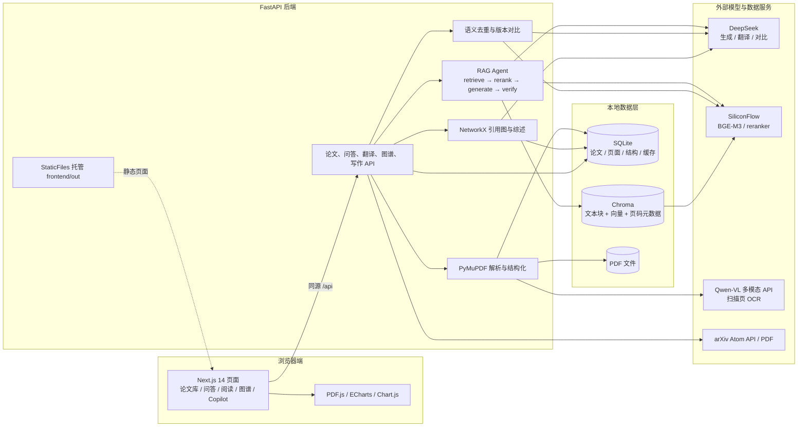

数据层职责明确：SQLite 保存论文元数据、逐页文本、结构化条目和综述缓存；Chroma 保存检索片段及 `(paper_id, filename, page, chunk)` 元数据；原始 PDF 作为文件保存，供 PDF.js 按需加载。密钥只通过 `.env` 注入，不进入源码和 Git 历史。

## 1.4 主要创新点

1. **把“抗幻觉”做成闭环而非一句提示词。** 生成后还要校验页码和引用句，失败会扩大召回并重试，最终无法核实的引用标记会被删除。
2. **溯源锚点贯穿数据模型。** 页码从 PDF 解析阶段写入元数据，不由模型自行猜测；前端可点击徽章回查原文片段。
3. **语义版本管理。** 不依赖文件名，使用全文语义指纹检测 v1/v7，并把“重复预警”进一步升级为“修订内容理解”。
4. **阅读、引用与写作联动。** 同一套分页文本和 References 结构同时服务翻译、引用跳转、图谱、综述和 Related Work 引用校验。
5. **可解释的基石文献评分。** 不只展示图，还给出 PageRank、正文提及、经典度和新鲜度的加权依据。

# 第2章 技术选型与理由

本章对应赛题对 AI 技术选型理由的要求。选型原则是：优先保证溯源深度和完整闭环，减少部署组件，控制模型调用成本。

| 技术 | 选择理由 | 取舍与应对 |
|---|---|---|
| **Next.js 14 App Router** | React 组件适合论文库、阅读器、图谱等复杂交互；`output: "export"` 可静态导出，便于单容器同域部署 | 不依赖服务端渲染，页面使用客户端请求；`/read?paper_id=24` 等 query 路由静态导出后仍可使用 |
| **FastAPI** | Python 生态与 PyMuPDF、NetworkX、Chroma 集成顺畅；类型声明、异步接口和自动 Swagger 文档提高开发与验收效率 | OCR、embedding 等外部请求有超时与并发控制；长索引任务放后台，上传请求不等待全部向量化 |
| **Chroma** | 本地嵌入式、零独立服务、支持持久化和余弦距离，适合比赛环境快速交付 | 当前规模下单机足够；多用户和高并发场景可迁移到专用向量数据库 |
| **BGE-M3** | 支持多语言和较长上下文，适合中英文学术文本；SiliconFlow API 免去本地模型部署，1024 维向量兼顾效果与成本 | 入库和查询固定使用同一模型；去重样本截为 15000 字，避免超出输入限制 |
| **bge-reranker-v2-m3** | 向量召回负责“找大致相关”，交叉重排负责“判断问题与片段是否真正匹配”，两段式比单纯 top-k 更稳 | 平台旧 `bge-reranker-large` 已不可用，因此模型名通过环境变量配置；重排失败退回向量排序 |
| **DeepSeek-chat** | 中文指令遵循和学术文本生成能力满足需求，API 成本适合频繁问答、翻译、图注和版本对比 | 通过低温度、结构化 JSON、有限上下文和后端校验降低不确定性，不把模型自我保证当作事实验证 |
| **PyMuPDF** | 解析速度快，逐页文本、页码和页面渲染接口统一，适合 541 页长文档 | PDF 本身无文本层时不能靠增强解析参数解决，必须进入 OCR 分支 |
| **Qwen-VL 多模态 API** | 扫描页、公式和表格识别无需本地下载 OCR 模型；按需调用降低环境复杂度 | 外部服务可能超时或限流，采用 150dpi、4 页并发、300 秒超时和单页一次重试 |
| **PDF.js** | 浏览器端保留原版布局，canvas 与文本层可同时支持清晰展示和划词 | 固定使用已验证的 4.10.38 与本地 worker，避免新版本浏览器兼容和 CDN 不稳定 |
| **NetworkX + ECharts** | NetworkX 便于计算加权 PageRank；ECharts graph 力导向、邻接高亮和缩放控制成熟，适合最终交互 | 曾使用 React Flow，因视野适配和空白 MiniMap 问题重构为 ECharts；保留后端接口不变 |
| **SQLite** | 与 Python 集成简单，论文、页面、结构化和缓存均为关系型数据，零部署且便于演示备份 | 当前无多用户并发写需求；正式多人系统可替换 PostgreSQL |

**Agent 编排说明：** 项目初期考虑 LangGraph，但当前流程只有四个阶段和一条回退边。最终采用 `backend/app/agent.py` 中的显式状态循环，完整表达 retrieve → rerank → generate → verify 与最多两轮重检索。这样不新增重型依赖，评委可以直接阅读全部状态转移；trajectory 仍记录阶段、状态、轮次和耗时，保留了 Agent 的可观测性。

# 第3章 核心模块设计与实现

## 3.1 PDF 解析、OCR 与结构化

### 3.1.1 页级解析与扫描页识别

上传接口接收 PDF 后，先保存原文件，再由 `pdf_parser.py` 逐页处理。矢量页调用 `page.get_text("text")`，页码从 1 开始，与阅读器和答案徽章一致。若一页提取文本少于 `OCR_MIN_CHARS=50`，则判定为疑似扫描页：

1. 以 150dpi 渲染为 PNG；
2. 使用最多 4 路并发调用多模态模型；
3. OCR 指令要求按阅读顺序输出纯文本，表格按行、公式用 Unicode 近似，禁止 Markdown 和 LaTeX 排版标记；
4. 单页超时为 300 秒，空文本或读取超时允许重试一次；
5. 单页失败不影响其余页面，失败页不会伪装成“OCR 成功”。

真实回归中，`1706.03762v1_img.pdf` 的 15 页全部 OCR 成功，`empty_pages=0`，得到 37,741 字符并建立 94 条向量。此前第 2 页曾因 180 秒读超时丢失，调整为 300 秒并重试后，该页约 140 秒完成识别。相关修复与结果留痕于 commit `d77a845`。

### 3.1.2 结构化抽取

`structure.py` 采用“规则优先、LLM 兜底”的策略：标题位置、章节编号、表格线和 `[n]` 引用具有稳定版式，规则可解释、可复现且零调用成本；首页标题和作者规则完全无法抽取时才调用一次 LLM。

- 标题树兼容 `3.1` 与标题分两行、或编号与标题同一行两类 PDF；
- 抽取标题、作者机构、摘要、表格、公式和 References，写入 `structure(paper_id, type, content, level, page_num)`；
- References 取文档中最后一次独立出现的 `References` 标题，避开正文同名字样；
- 参考文献跨页拼接时保留字符区间到页码的映射，同编号跨页残片保留文本最长的一条；
- 正文扫描 `[n]`，记录每个编号的首现页、提及次数和堆叠引用。

正文 RAG 切块则保持页边界，防止一个片段同时对应两个页码；页内先合并 PDF 造成的碎裂换行，再按句边界和重叠字符处理。换言之，**跨页合并用于 References 结构恢复，正文检索块使用页内断句修复与重叠保护**，两者都服务于可追溯性。

v7 实测抽取出 21 个章节标题（其中二级标题 12 个）、2 个 Markdown 表格、10 条公式和 40 条参考文献，标题、作者机构和摘要齐全。

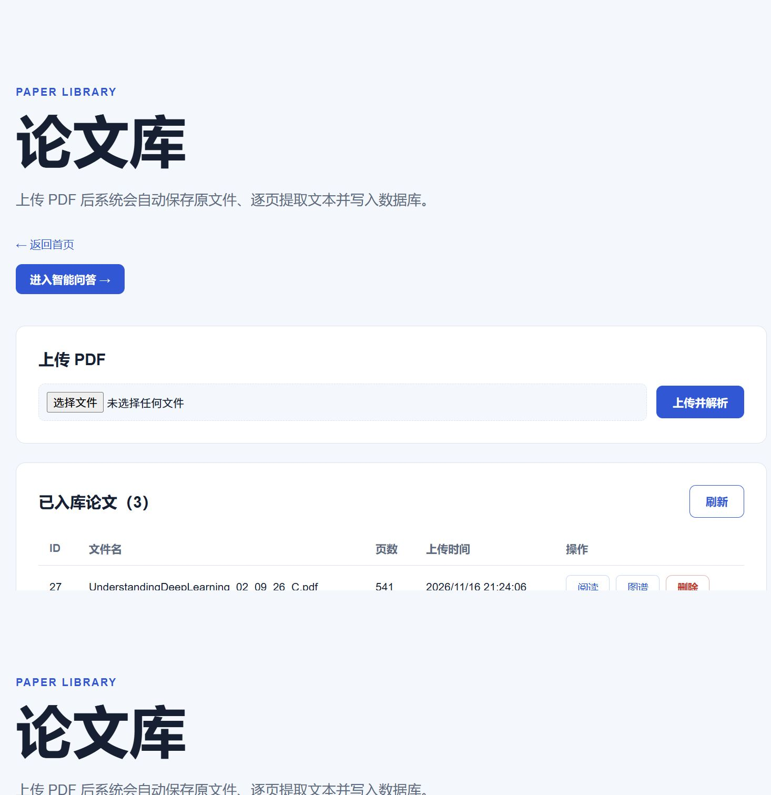

## 3.2 语义去重与版本差异对比

### 3.2.1 基于语义而非文件名

`dedupe.py` 将新论文全文前 15000 字作为语义指纹，与库内每篇论文的同样样本组成一次 batch embedding 请求，随后逐对计算余弦相似度：

\[
similarity(A,B)=\frac{A\cdot B}{\lVert A\rVert\lVert B\rVert}
\]

默认阈值为 **0.92**。该阈值来自官方样例与不同论文的对照：v1/v7 实测 0.9489，不同论文通常低于 0.7。文件名不参与相似度计算，因此改名不能绕过预警。

当分数超过阈值时，上传接口返回带暂存 token 的预警响应，文件和解析结果暂存于带锁的待确认队列。用户可选择：

- **保留两个版本**：作为独立论文入库；
- **覆盖旧版本**：删除旧论文及其向量，再保存新论文；
- **取消上传**：清理暂存文件；
- **对比版本差异**：只读暂存内容，不消费 token。

### 3.2.2 AI 修订摘要

版本对比不是简单 diff。系统分别取两版文本的开头 2000 字和结尾 2000 字，兼顾摘要、方法概述与结论，要求 DeepSeek 输出四类内容：总体判断、主要章节增删改、关键数字差异、一句话修订方向。官方样例中能够指出 EN-FR BLEU 从 41.0 到 41.8 的变化。

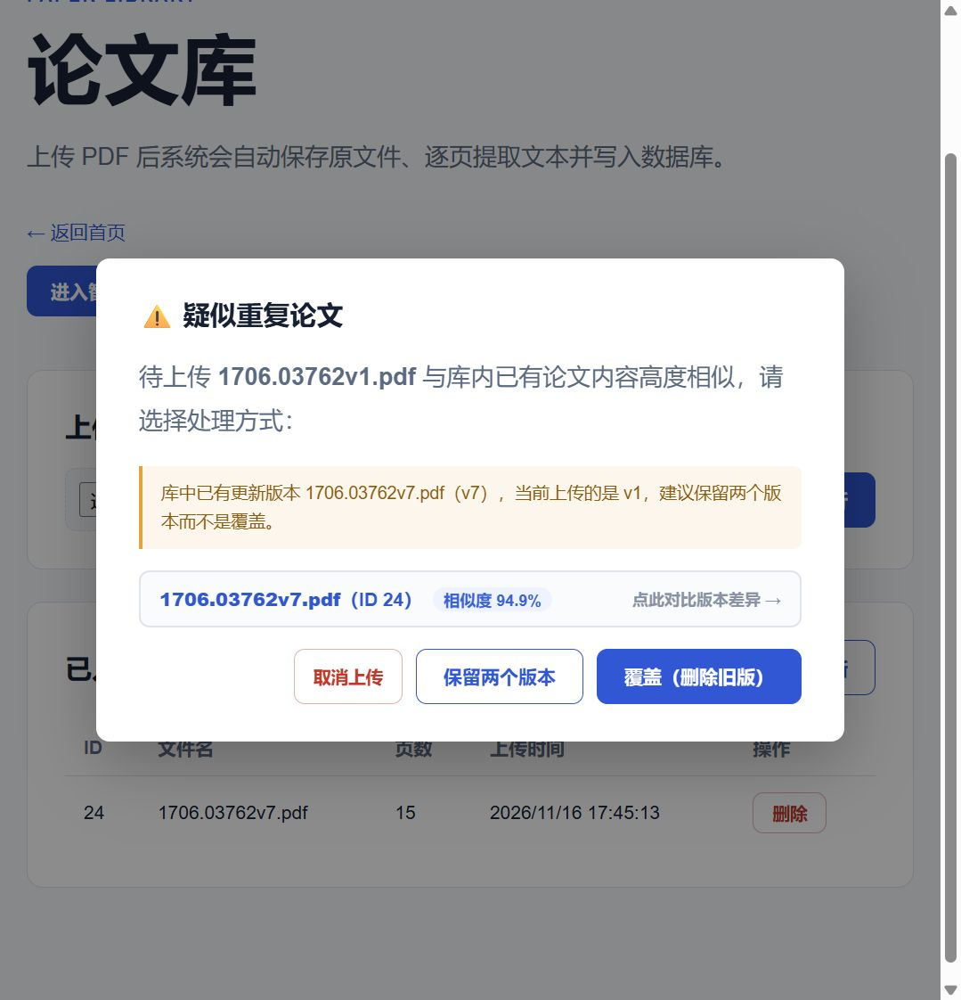

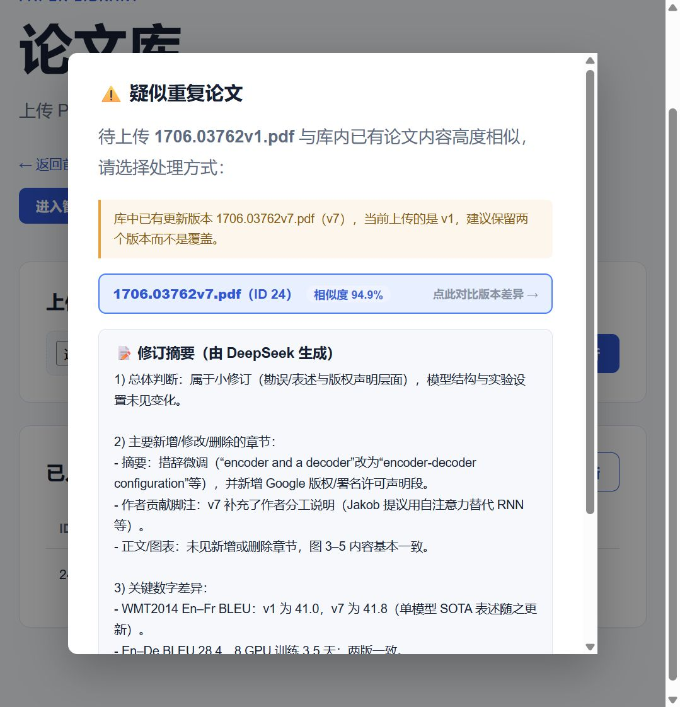

## 3.3 抗幻觉 RAG 与页码级溯源

### 3.3.1 切块、召回与精排

`rag.py` 将每页文本切成约 500 字符的片段，相邻块重叠 80 字符，并优先在窗口后半段的句号、问号、叹号或分号处断开。早期硬切曾把 “We used the Adam optimizer ...” 截断，导致优化器段落召回失败，因此句边界不是排版美化，而是检索正确性的必要条件。

每个块写入 Chroma 时都带有论文 ID、文件名、页码和块序号。查询过程为：

1. 中文问题可先改写为一句英文检索式；改写失败退回原问题；
2. BGE-M3 将问题向量化，默认召回 top 5；限定单篇时使用 `paper_id` 过滤；
3. 同一论文同一页只保留排名最高的一块，减少重叠块占用上下文；
4. reranker 精排后默认保留 3 块；重排异常时退回向量顺序；
5. 将带有真实文件名和页码标题的片段交给 DeepSeek。

生成提示词规定：每个事实后使用 `[第X页]`，页码只能来自片段标题，证据不足必须回答“检索到的原文中没有相关信息”，不得使用常识补齐。

### 3.3.2 Agent 四阶段与引用自检

`agent.py` 将普通 RAG 流水线扩展为可回退状态机：

| 阶段 | 行为 | trajectory 记录 |
|---|---|---|
| retrieve | 向量召回；重试时按轮次扩大 top-k | 候选数、覆盖论文数、耗时、attempt |
| rerank | 精排；重试新增页面而不是挤掉已通过页面 | 新增与累计片段数 |
| generate | DeepSeek 只依据当前上下文作答 | 答案长度、耗时 |
| verify | 抽取引用，检查页码存在及引用句与原页内容重叠 | 引用总数、通过数、失败标记 |

自检先确认 `[第X页]` 对应页面确实在检索上下文中，再检查引用句中的英文专业词、数字或中文二字词组是否与原文重叠。对纯中文改写英文原文的情况保留跨语言宽容，避免机械字符串比较误杀正常翻译。跨论文模式则同时校验 `[论文N 第X页]` 的论文编号和页码，防止把 A 论文的证据贴给 B 论文。

若校验失败，系统保持原查询语义并扩大召回，最多重试 2 轮；不会把模型生成的失败句拼回查询，以免引入噪声。重试耗尽后仍无法核实的引用标记会被删除。前端“Agent 推理轨迹”面板可回放上述过程。

跨论文对比由“对比、区别、演化”等意图词触发，最多覆盖 4 篇论文，每篇精排后最多保留 2 个片段，避免 541 页长文档凭片段数量淹没其他论文。

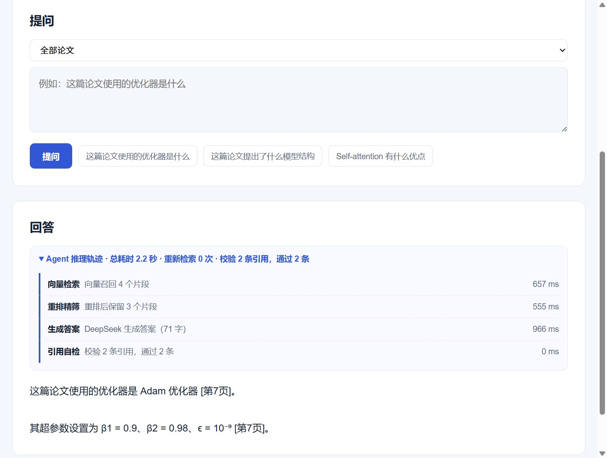

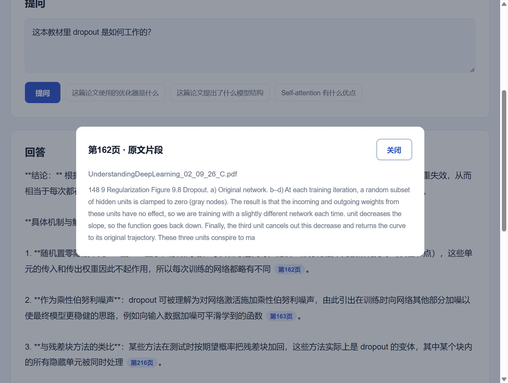

## 3.4 中英双语联动阅读

### 3.4.1 阅读与翻译

阅读页左侧由 PDF.js 4.10.38 渲染原版页面，worker 随前端本地部署；透明文本层把 `getTextContent()` 的文字片段按坐标绝对定位，并按 PDF 实际宽度进行横向缩放，使原版展示与鼠标划词可以同时成立。右侧提供中文翻译、参考文献和结构化视图。

- 支持划词翻译、整页翻译与整篇翻译；
- 相同文本和相同页面命中缓存后不再请求模型；
- 整篇翻译按页串行，展示 `x/15` 进度，避免并发触发限流；
- 标题树点击跳页，当前页归属“页码不超过当前页的最后一个标题”；
- 左右栏按可滚动区间比例同步，120ms 时间锁避免两个 scroll 事件相互触发；
- 正文 `[n]` 可跳到 References 并高亮，文献条目可回到该编号正文首现页。

### 3.4.2 按需渲染与并行加载优化

commit `16d70fa` 对阅读页做了针对性优化：

| 优化点 | 优化前 | 优化后 |
|---|---|---|
| PDF 传输 | 默认自动拉取，首屏可能等待无关页面 | `disableAutoFetch=true`、`disableStream=true`，Range 块为 64KB |
| 首屏任务 | PDF、文本、References、结构目录竞争首屏资源 | PDF 与当前页文本并行；References 点击标签时才加载，结构目录在首页可见后加载 |
| 画布与文本层 | 先等待画布，再提取文本 | `Promise.all` 并行执行 `render` 与 `getTextContent` |
| 翻页 | 每次重建 canvas 和文本层 | 只缓存当前页及前后各一页，首页可见 150ms 后预取邻居，离页立即释放 |
| 翻译 | 文本返回即请求，即使用户已离开 | 当前页真正可见后才翻译；缓存跨翻页保留 |
| 静态资源 | worker、JS 等传输体积较大 | 后端 GZip 压缩静态资源，但跳过 PDF，保留 Range 所需长度标头 |

15 页 v7 的整篇翻译实测约 35 秒，完成后再次进入不重复请求；同步滚动实测左栏 `scrollTop=500` 时右栏为 382，对应两栏可滚动区间比例 610/798。优化提交记录了 64KB 在公网测试中优于 512KB 的选择，但**现有 Git 与 PROGRESS 未留存旧版和优化版首屏毫秒耗时的成组原始数据**，因此本文不编造“提升百分比”，第4章给出正式补测方法。

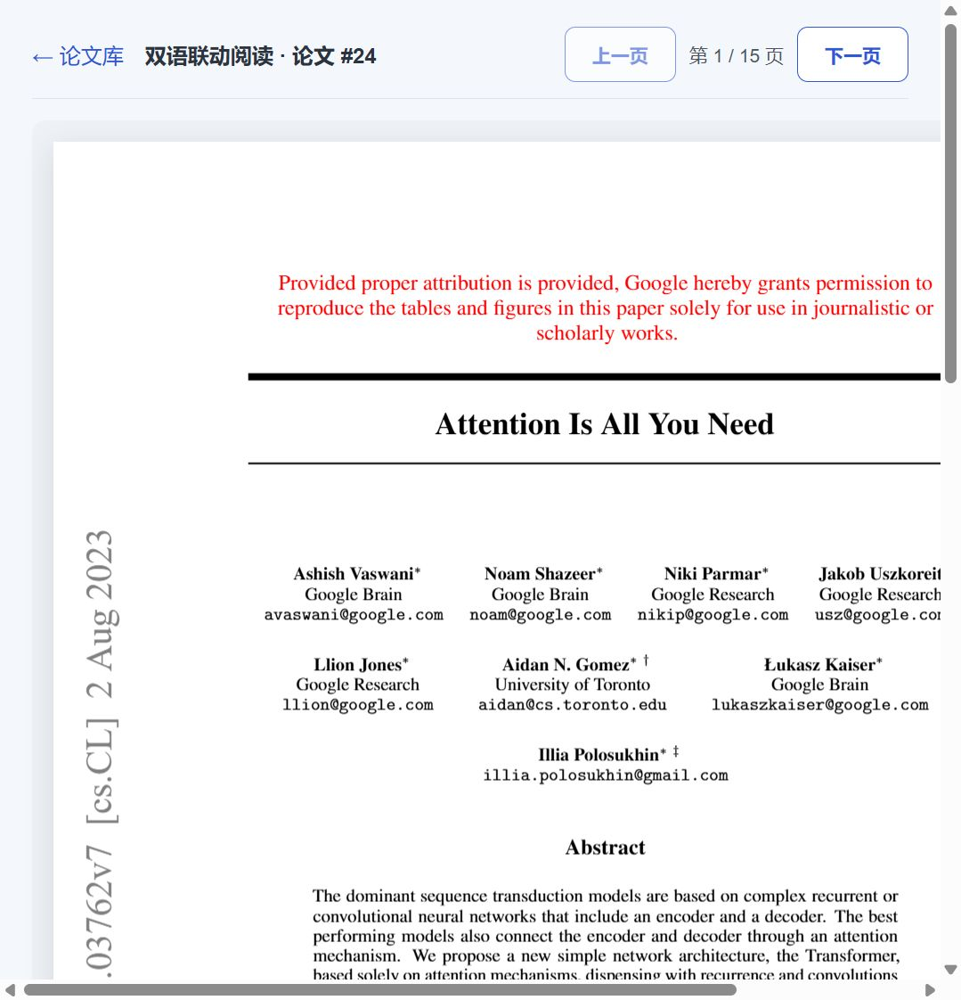

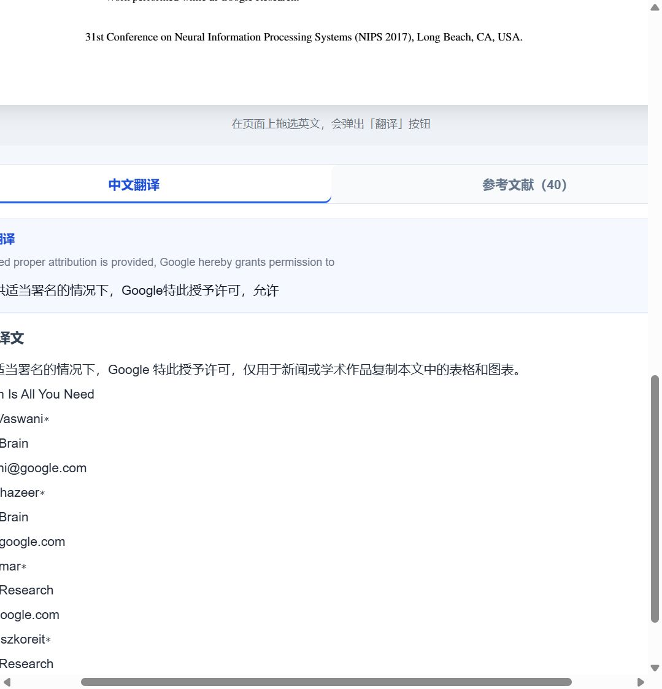

## 3.5 引用图谱与自动综述

### 3.5.1 图谱构建与基石文献评分

`citations.py` 复用 References 解析结果，将“本论文 → 被引文献”建成有向图，边权为 `1 + 正文提及次数`。作者名缩写可能误触发句号分段，因此标题解析加入缩写识别和候选片段打分，并修复 `Convolu- tional` 一类 PDF 断词。

加权 PageRank 反映图结构与作者依赖程度，但星型单篇引用图中叶节点分数容易接近，所以又叠加正文提及、领域经典度和年份新鲜度：

\[
importance=100\times(0.35\times PageRank_{norm}+0.15\times Mention_{norm}+0.40\times Fame+0.10\times Recency)
\]

其中经典度来自 LSTM、Adam、ResNet、BatchNorm、Dropout、word2vec 等具体工作及顶会关键词；通用词 attention 权重较低。年份在 20 年窗口内线性衰减。接口返回节点、边、原始条目、PageRank、importance 和 Top5 理由。

前端最终使用 ECharts force 图：中心论文固定，节点大小映射 importance，基石文献使用橙金光晕，曲线连接，hover 只突出邻接节点，点击打开详情抽屉，并提供放大、缩小和复位。v7 实测 `node_count=40`、40 条引用边；早期全景截图包含 1 个中心节点和 40 个被引节点，共 41 个显示节点。

### 3.5.2 自动综述与 Future Work

`survey.py` 不塞入整篇全文，而选取标题/摘要、importance 前 8 的参考文献、Future Work/Limitation/Discussion 段落（最多 2500 字）。模型必须输出：

- 300—500 字综述，依次包含“研究脉络、主流方法、代表工作”三段；
- 每个论断绑定材料中真实存在的 `[n]`；
- 恰好 3 个未来方向，每条包含 `title`、`why` 和 `prior_work`；
- `prior_work` 明确已有工作解决了什么，避免把论文已经完成的方案重新包装成未来 idea。

结果写入 `survey_cache`，同一论文重复打开不重复计费；用户也可主动刷新。

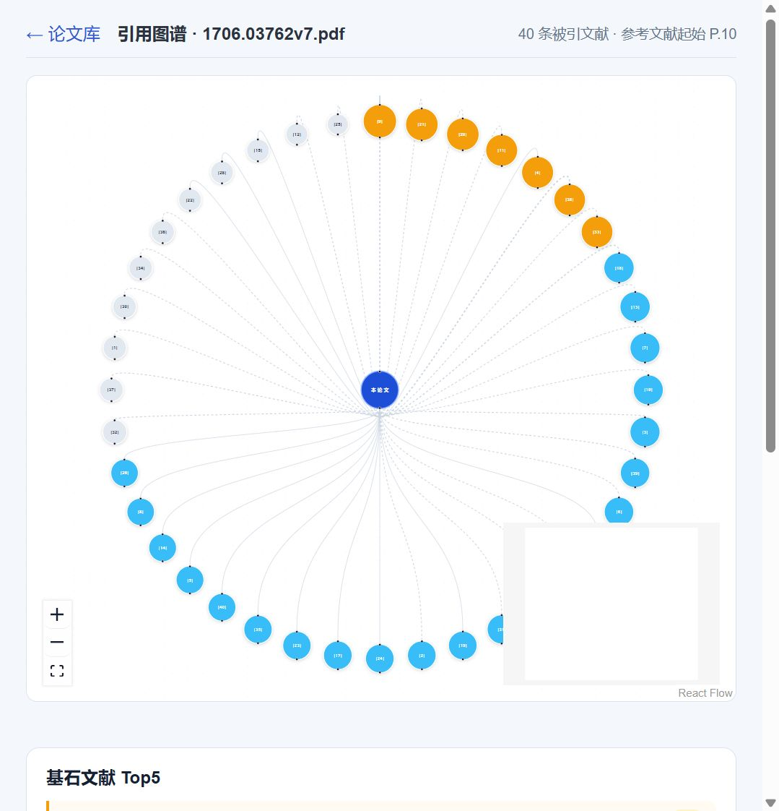

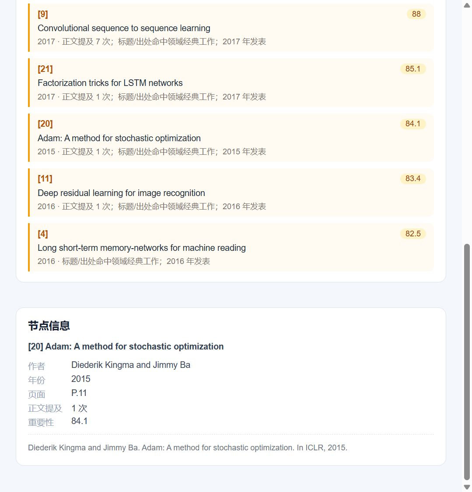

## 3.6 arXiv 导入与推荐

`arxiv_client.py` 使用官方 Atom API，支持两类输入：

1. `1706.03762`、`arXiv:1706.03762v7` 或旧式分类 ID，使用 `id_list` 精确查询；
2. 标题或关键词，使用 `search_query=all:...` 并按相关度降序，多词短语整体加引号，避免被拆成 OR 检索。

解析条目时保留标题、作者、年份、摘要、abs/PDF 地址和 comment，并从摘要与 comment 中提取 GitHub 仓库链接。下载后校验 `%PDF` 文件头，防止把限流 HTML 错误页当成论文，然后复用统一的上传、OCR、结构化和索引链路。

推荐功能从库内论文提取主题关键词，进行 arXiv 多关键词组合检索，按关键词共现比例和年份排序，默认返回 3 篇，同时展示匹配关键词与开源复现徽章。参考文献另有“含金量”评分：基准 30 分，库内已收录、经典工作、Related Work 出现和正文多次提及加分，纯堆叠引用或无具体描述减分，低价值条目可折叠。

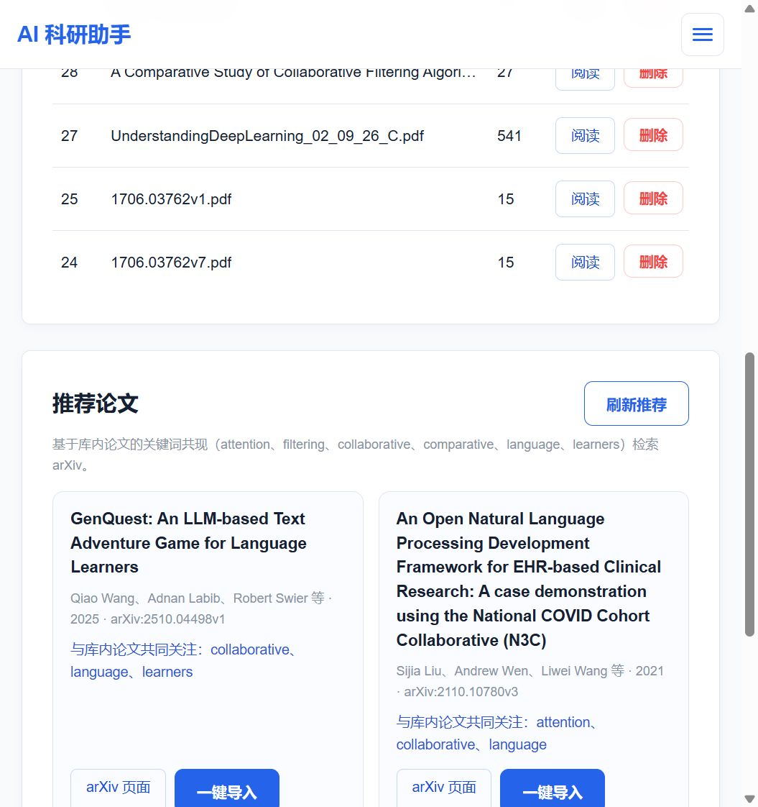

## 3.7 学术写作 Copilot

### 3.7.1 无幻觉论文框架与架构图

用户输入研究想法后，后端把本地文献清单以 `L<ID> | 标题 | 年份` 的形式提供给模型，要求生成 Abstract、Introduction、Method、Experiment、Conclusion 和 Related Work 六部分。Related Work 引用键只能来自清单；后端再次把 `L<ID>` 映射到 SQLite，库内不存在的编号直接丢弃，前端不会出现无法找到 PDF 的参考文献。

架构图要求返回合法 Mermaid flowchart，后端清理模型偶尔附加的代码块并检查语法开头；不合法时使用通用兜底图，保证页面不空白。TikZ 仅保留可选脚本输出，没有把本地 LaTeX 编译链作为核心依赖。

### 3.7.2 CSV 学术图表与图注

CSV 接口兼容 UTF-8 BOM、GBK 和 Latin-1，最多读取 5000 行。某列至少 80% 非空值可转数值时判为 numeric，给出 min/max/mean/median；否则判为 category，给出 distinct 和样例。前端选择第一个类别列和第一个数值列作为默认坐标，使用 Chart.js 切换柱状图、折线图和表格。

DeepSeek 只收到列统计与样本，要求英文 2—3 句、中文 1—2 句，只依据真实数据总结趋势，输出 JSON。接口统一补 `Figure 1.` 前缀；模型不可用或 JSON 解析失败时，以本地统计生成兜底图注。示例 `transformer_bleu.csv` 为 9 行、5 列，正确识别 model/task 为类别列，bleu/train_hours/params_m 为数值列，并生成包含 Transformer big 的 28.4 EN-DE、41.0 EN-FR 的图注。

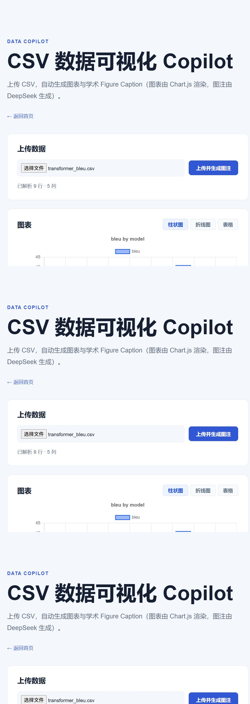

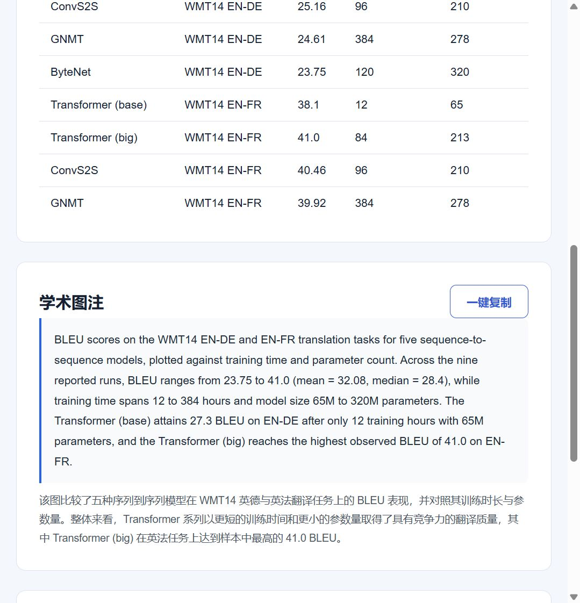

# 第4章 测试与验证

## 4.1 官方验收用例

测试以 `pdf/` 中的官方文件为输入，上传、解析、检索和前端操作均走真实接口。结果如下。

| 官方用例与步骤 | 实测结果 | 证据 |
|---|---|---|
| 先上传 `1706.03762v7.pdf` | 直接入库，列表新增 1 条，无重复弹窗 | `.screenshots/dedupe/1-v7直接入库.jpg` |
| 再上传 `1706.03762v1.pdf` | 触发预警，与 v7 相似度 **94.9%**；提示库内已有更新版本 | `.screenshots/dedupe/2-v1触发预警94.9.jpg` |
| 点击版本差异 | DeepSeek 给出修订摘要，包含 EN-FR BLEU 41.0 → 41.8 | `.screenshots/dedupe/3-DeepSeek修订摘要.jpg` |
| 选择保留两个版本 | 弹窗关闭，v7 与 v1 两条记录同时存在 | `.screenshots/dedupe/4-保留两个版本后2条.jpg` |
| 将 v1 改名 `mypaper.pdf` 再上传 | 仍预警；与库内 v1 为 **100.0%**、与 v7 为 **94.9%**，证明不依赖文件名 | `.screenshots/dedupe/5-改名mypaper仍预警.jpg` |
| 上传 `1706.03762v1_img.pdf` | **15/15 页 OCR 成功**，`empty_pages=0`，37,741 字符，94 条向量 | commit `d77a845` 真实接口回归记录 |
| 上传 541 页 `UnderstandingDeepLearning_02_09_26_C.pdf` | 上传与解析 **9.74s**，1,314,451 字符，峰值内存 **352MB**，3,716 chunks | `screenshots/large-pdf/`、commit `0b9f291` |

长文档的 541 页均完成遍历；其中 537 页具有可索引文本，低文本页不会硬塞入向量库。指定页检索能够命中目标片段，原文弹窗与页码一致，说明“大文件能上传”之外也完成了“大文件可检索、可溯源”。

## 4.2 RAG 正确性、Agent 与溯源

| 测试问题 | 结果 | 校验情况 |
|---|---|---|
| “这篇论文用的优化器是什么”（限定 v7，ID 24） | 回答 Adam，并给出 β1=0.9、β2=0.98、ε=10⁻⁹ | 两个“第7页”徽章；2 条引用通过 2 条；重检索 0 次；该轮 Agent 约 2.2s |
| “big model 的 BLEU 分数是多少” | 回答英法 41.0 `[第8页]`，并指出第1页另有 41.8，说明口径不同 | 两个页面均有真实片段，避免把不同实验设置混为一个数字 |
| “这几篇论文在模型架构上有什么区别” | 进入跨论文模式，覆盖并引用 3 篇不同论文 | 每篇最多 2 块；按论文编号与页码联合校验 |
| 无参考文献论文打开图谱 | 返回 `node_count=0`，页面显示空状态，生成综述禁用 | 修复了空集合 `max()` 导致的 500，不白屏 |

最新回归中，优化器答案的源片段包含 “We used the Adam optimizer”，点击徽章可直接核对。引用自检不是只检查徽章格式，而是检查页码是否属于本轮证据及引用句是否存在内容重叠。

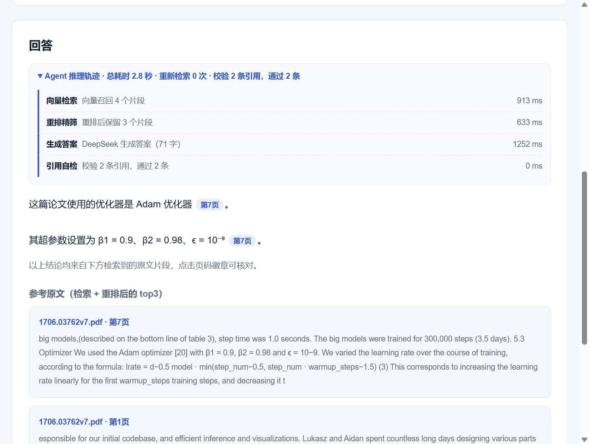

## 4.3 阅读、图谱与写作功能验证

| 模块 | 实测结果 |
|---|---|
| 标题树 | v7 共 21 条 heading，点击跳页，当前标题随页码高亮 |
| 整篇翻译 | 15 页进度递增至完成，约 35s；缓存后重进不重复请求 |
| 同步滚动 | 左栏 scrollTop 500 → 右栏 382，比例与可滚动区间一致；关闭开关后不再联动 |
| 引用跳转 | 正文 `[3]` 跳转并高亮 References `[3]`，条目可回正文首现 P.4 |
| 引用图谱 | `node_count=40`、40 条边；节点点击显示作者、年份、页码、提及、importance、PageRank 和原文 |
| 图谱缩放 | 点击放大两次内容包围盒 655→753，复位回 656，缩小回 559；整群居中 |
| CSV Copilot | 9×5 示例正确判列；柱状、折线、表格可切换；图注可复制 |

## 4.4 阅读性能数据与复测约定

已留存的量化结果包括：整篇 15 页翻译约 35 秒、Range 块 64KB、页面缓存最多 3 页、邻居预取延迟 150ms、图谱页首屏 JS 约 260KB，以及第4.1节的长文档数据。优化前后的行为差异见第3.4.2节。

由于旧版首屏耗时没有形成可复核的成组记录，本初稿不填写虚构的“从 X ms 降至 Y ms”。正式转 PDF 前如需增加首屏耗时对比，应在同一台机器、同一网络、同一 PDF 下分别对 `16d70fa^` 与 `16d70fa` 冷缓存各测 5 次，记录以下指标并取中位数：

1. `getDocument` promise resolve 时间；
2. 第一页 canvas 与文本层同时可见时间；
3. 首屏 PDF 字节数和请求数；
4. 翻到已预取相邻页的渲染耗时；
5. 翻译请求次数与缓存命中次数。

这样可以区分网络传输、PDF 渲染和 LLM 翻译三类耗时，避免把模型延迟误当前端优化收益。

## 4.5 视觉回归与移动端

阶段收尾对 `/`、`/papers`、`/read?paper_id=24`、`/ask`、`/graph?paper_id=24`、`/copilot` 六页逐页回归：主内容正常、无白屏、无错误横幅，浏览器 console 无错误。375px 视口下六页导航均折叠，无页面级横向溢出；阅读页在窄屏改为网格可收缩，PDF 区域内部横向滚动。`pnpm build` 全部通过。

# 第5章 AI 协同贡献与 Prompt 调优策略

## 5.1 人与 AI 的分工

本项目采用“开发者负责目标与验收，AI 负责高频实现与排查”的协同方式，而不是把需求一次性交给模型生成整站。

| 工作 | 开发者贡献 | AI 贡献 |
|---|---|---|
| 任务拆解 | 按 P0/P1/P2 确定优先级，明确官方验收用例与不可破坏约束 | 将阶段任务细化成可提交的小步骤 |
| 架构决策 | 确认技术栈、模块取舍、部署方案和是否重构 | 提供方案对比，说明依赖、风险与实现成本 |
| 编码实现 | 审查关键数据流和页面行为 | 编写 FastAPI/React、解析规则、RAG、图谱和样式，按反馈迭代 |
| 调试排错 | 提供完整报错与复现路径，决定是否回滚 | 分析 PDF.js 兼容、引用错位、首屏空白、窄屏溢出等问题并修复 |
| 测试验收 | 制定“必须带页码”“改名仍预警”等验收标准 | 执行接口、构建和浏览器回归，保存截图与数值 |
| 文档表达 | 确认哪些结果真实可写，审阅技术叙述 | 根据代码、Git 和 PROGRESS 整理文档与演示脚本初稿 |

AI 的贡献不仅是代码行数，还包括提出反例、定位隐性假设和保留可核验记录。例如：机械硬切导致 Adam 段落漏检、星型图 PageRank 区分度不足、作者缩写造成 References 标题错位，都是在实际测试后由人机共同发现的问题。

## 5.2 约束驱动的工作流

1. 以 `PROJECT.md` / `AGENTS.md` 作为项目宪法，锁定目标、技术栈、密钥约束与验收用例；
2. 每次只下发一个边界清晰的任务，要求说明改动文件、验证命令和模块原理；
3. 每个子任务完成后立即构建或实测，再 commit，确保任何阶段可回滚；
4. 用 `PROGRESS.md` 记录完成项、真实报错、阻塞原因、实测数字和下一步；
5. 长会话约 50 轮后容易出现上下文衰减，采用“新会话 + PROGRESS + 交接摘要”恢复状态，而不是让 AI 凭印象继续；
6. 核心问答或页面被改坏时优先 revert 到最近可用 commit，演示稳定性优先于局部美化。

Git 历史能够对应关键迭代：`d77a845` OCR 真实回归、`8e8df52` Agent 自检、`eb0d58b` 跨论文对比、`0d1e7b0` 结构化解析、`0b9f291` 541 页验证、`16d70fa` 阅读优化、`2b3e514` ECharts 重构，以及后续五个视觉收尾提交。

## 5.3 Prompt 与规则调优实例

### 实例一：从文件名匹配到语义指纹

**问题：** v1/v7 可能改名，文件名规则无法表达“内容近似但版本不同”。<br>
**调整：** 不再让模型判断文件名，而是要求系统对全文样本做 BGE-M3 embedding，使用余弦阈值 0.92；阈值由 v1/v7 的 0.9489 和不同论文约 0.7 以下的对照确定。<br>
**结果：** `mypaper.pdf` 仍触发预警，同时保留用户决定权，不自动删除旧版本。

### 实例二：从固定硬切到句边界与重叠

**问题：** 500 字硬切把优化器句子截断，切块虽然整齐但检索不到 Adam。<br>
**调整：** 切块指令从“严格每 500 字”改为“约 500 字、后半窗优先句末、相邻重叠 80 字”；查询提示词同时限制只能用片段页码。<br>
**结果：** 优化器问题稳定召回第 7 页，回答包含 Adam 与超参数，引用可打开原文核对。

### 实例三：从“请模型不要编”到引用自检回退

**问题：** 只在 Prompt 中写“不要幻觉”无法保证页码真实，模型可能给正确结论配错页。<br>
**调整：** 增加 verify 阶段，逐个抽取 `[第X页]`，验证页面存在与内容重叠；失败时保持原问题并扩大 top-k，最多 2 轮；最终仍失败删除引用标记。重试查询不拼入模型生成的失败句，避免噪声把检索带向 References。<br>
**结果：** 系统形成“生成—证伪—补证—降级”的闭环，trajectory 可以解释每一次重试，而不是隐藏失败。

### 实例四：OCR 输出从排版还原改为检索友好文本

**问题：** 早期允许 LaTeX，模型把整页包进 `\begin{center}` 等命令，污染检索与展示。<br>
**调整：** OCR Prompt 明确要求纯文本、阅读顺序、表格按行、公式用 Unicode 近似、禁止 Markdown/LaTeX，温度设 0；工程侧补充 300 秒超时与一次重试。<br>
**结果：** 15 页扫描件全部识别成功并建立 94 条向量。

### 实例五：Future Work 增加“已有工作”字段

**问题：** 通用“给三个未来方向”容易把论文已经解决的问题重新生成一遍。<br>
**调整：** 结构化 JSON 中强制加入 `prior_work`，同时提供论文 Limitation/Future Work 原文和 Top8 引用，要求说明“哪些坑已被填”。<br>
**结果：** 未来方向不仅包含为什么值得做，还必须交代与已有方案的边界。

## 5.4 开发者主导的关键取舍

- **砍非核心编译链，保溯源深度。** TikZ 保留可选代码输出，但优先完成引用自检、原文弹窗和重试，而不是投入本地 LaTeX 环境。
- **部署从云平台改为内网穿透。** Render 访问与网络条件不适合当前演示，改用 FastAPI 同域托管静态前端，再由 cpolar 暴露唯一端口。
- **ECharts 替换 React Flow。** 为解决 MiniMap 空白、初始 fitView 裁切和缩放控制问题，保留后端图谱数据，重构前端渲染层。
- **Agent 采用轻量显式状态机。** 四阶段加回退边无需引入框架即可完整表达，把可解释性和排错效率放在框架形式之前。

# 第6章 已知限制与未来工作

| 当前限制 | 影响 | 后续工作 |
|---|---|---|
| arXiv 目前为主动检索与推荐 | 不能持续追踪某主题并推送新论文 | 增加订阅、定时任务、去重历史与邮件/消息推送 |
| TikZ 只输出脚本，不内置编译 | 用户需在本地 LaTeX 环境编译 | 在隔离容器中提供安全编译与预览，继续保留 Mermaid 即时预览 |
| 整篇翻译按页串行 | 15 页约 35 秒，541 页成本和等待明显增加 | 小并发、相邻页预取、持久化任务队列、按章节选择与断点续传 |
| 翻译缓存和综述缓存以当前进程/单库为主 | 多实例部署不能天然共享全部缓存 | 引入共享缓存与任务状态，设置失效策略 |
| 无登录与多用户权限 | 适合单机演示，不适合多人私有文献隔离 | 增加账户、工作空间、权限与配额管理 |
| cpolar 免费随机域名依赖开发机在线 | 隧道重建地址可能变化，可用性受本机网络影响 | 迁移云服务器，固定域名、HTTPS、进程守护与数据备份 |
| OCR 和模型调用依赖外部服务 | 余额、限流和网络会影响上传或生成 | 提供明确任务状态、重试与多供应商配置；扫描件结果持久化避免重复识别 |
| 引用校验包含启发式 overlap | 能抓页码错配，但不能等同于完整事实一致性证明 | 引入自然语言推理对齐、句级证据定位和人工确认工作流 |
| 当前图以单篇论文的出边为主 | 不是全库论文之间的完整引用网络 | 通过 DOI/arXiv ID/标题对齐连接库内论文，支持多跳与路径分析 |
| 旧版首屏耗时原始记录不完整 | 不能给出严格的优化前后百分比 | 按第4.4节协议补测并公开原始样本 |

未来还将增强正文跨页段落恢复，但必须继续保留块到页码的映射；对公式、双栏和复杂表格的结构化质量，也需要建立带人工标准答案的小型评测集，而不能只凭页面看起来正常判断。

# 第7章 运行指南

## 7.1 环境准备

- Node.js 20+ 与 pnpm；
- Python 3.11+ 与 uv；
- Git；Docker 可选；
- 在项目根目录复制 `.env.example` 为 `.env`，填写密钥。

| 环境变量 | 必填 | 用途 |
|---|---|---|
| `DEEPSEEK_API_KEY` | 是 | 问答、翻译、对比、综述与写作 |
| `SILICONFLOW_API_KEY` | 是 | BGE-M3 embedding 与 reranker |
| `MULTIMODAL_API_KEY` | 否 | OCR；留空复用 SiliconFlow 密钥 |
| `DEEPSEEK_BASE_URL` / `SILICONFLOW_BASE_URL` | 否 | 自定义模型网关 |
| `MULTIMODAL_BASE_URL` / `VISION_MODEL` | 否 | 切换多模态供应商或模型 |
| `CHAT_MODEL` / `EMBEDDING_MODEL` / `RERANK_MODEL` | 否 | 覆盖默认模型 |
| `RETRIEVE_TOP_K` / `RERANK_TOP_K` | 否 | 默认 5 / 3 |
| `CHUNK_SIZE` / `CHUNK_OVERLAP` | 否 | 默认 500 / 80 |
| `OCR_MIN_CHARS` / `OCR_DPI` / `OCR_CONCURRENCY` | 否 | 默认 50 / 150 / 4 |

`.env` 已被 Git 忽略，仓库只跟踪 `.env.example`。不得把真实密钥、cpolar token 或账户信息写入源码、截图和演示视频。

## 7.2 本地同域启动

以下命令在 PowerShell 中执行：

```powershell
Set-Location d:\keijizhushou\frontend
pnpm install
pnpm build

Set-Location d:\keijizhushou\backend
py -m uv sync
py -m uv run uvicorn app.main:app --host 127.0.0.1 --port 8000
```

访问：

- 系统：<http://127.0.0.1:8000>
- Swagger：<http://127.0.0.1:8000/docs>
- 健康检查：<http://127.0.0.1:8000/api/health>

前端修改后需重新 `pnpm build`。演示去重流程不要使用 `--reload`，避免重载清空内存中的待确认 token。

前后端分离开发时可运行 `pnpm dev`，访问 <http://localhost:3000>，并在 `frontend/.env.local` 设置：

```bash
NEXT_PUBLIC_API_BASE=http://127.0.0.1:8000
```

## 7.3 Docker 启动

```powershell
docker build -t research-assistant .
docker run --rm -p 7860:7860 --env-file .env research-assistant
```

访问 <http://127.0.0.1:7860>。两阶段 Dockerfile 先导出 Next.js 静态站点，再在 Python 镜像中安装后端依赖并启动 uvicorn。

## 7.4 测试数据与建议验收顺序

| 文件 | 用途 |
|---|---|
| `pdf/1706.03762v7.pdf` | RAG、双语阅读、图谱的主测试论文 |
| `pdf/1706.03762v1.pdf` | v7 入库后的语义去重与版本对比 |
| `pdf/1706.03762v1_img.pdf` | 15 页扫描件 OCR 与索引 |
| `pdf/UnderstandingDeepLearning_02_09_26_C.pdf` | 541 页长文档稳定性与指定页检索 |
| `samples/transformer_bleu.csv` | CSV 图表与学术图注 |

建议先清空或备份测试库，再按 v7 → v1 → 改名 v1 的顺序验证去重；扫描件 OCR 耗时较长，可提前入库；随后限定 v7 提问“这篇论文用的优化器是什么”，检查 Adam、β 参数、第 7 页徽章和原文弹窗；最后上传 541 页教材并验证指定页检索。

公网评审直接使用 <http://25d17385.r1.cpolar.top>，当前无需账号。服务由内网穿透承载，评审时段需保持开发机、后端进程与 cpolar 隧道在线。完整操作讲解与录制注意事项见 `docs/演示视频脚本.md`，逐项实测历史见 `PROGRESS.md`。
